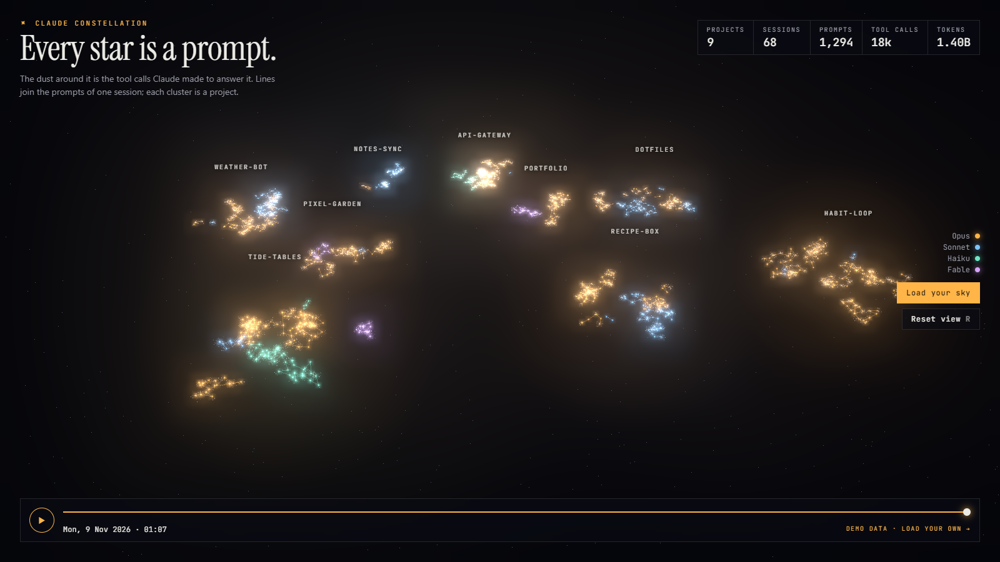
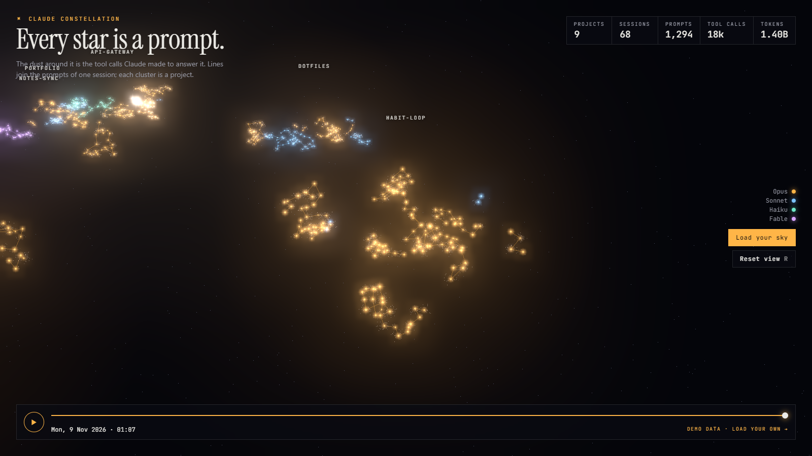
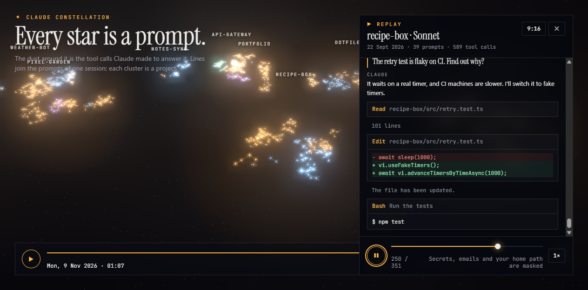

# Claude Constellation

**Every star is a prompt.** Your Claude Code history as a 3D night sky: each prompt you sent is a star, the dust around it is the tool calls Claude made to answer it, lines join the prompts of one session, and each cluster is a project. Press play and watch the sky light up in the order you worked.

**[Live demo →](https://jasperntc.github.io/claude-constellation/)** (made-up data)



## See your own sky

Needs Node 22.18 or later, and Claude Code transcripts on this machine.

```bash
npx github:jasperntc/claude-constellation
```

It reads `~/.claude/projects`, then opens your sky on `http://localhost:4173`. Your numbers stay on your machine: the server listens on loopback only and refuses requests for any other host name, so a web page can't reach it through DNS rebinding. The only outside request is for the Google Fonts stylesheet.

To share a sky, or view it on the demo site, write the totals to a file and drop it on the page:

```bash
npx github:jasperntc/claude-constellation --out constellation.json --exclude client-repo
```

The file loads into the browser tab. Nothing is uploaded.

| Flag | What it does |
|---|---|
| `-o, --out <file>` | Write the totals to a JSON file instead of serving |
| `-x, --exclude a,b` | Leave projects out, for example client work |
| `--dir <path>` | Read transcripts from another folder |
| `--port <n>` | Port for the local page (default 4173) |
| `--no-open` | Don't open a browser |
| `--demo` | Serve the page with made-up data |

## What leaves your transcripts

Only totals: token counts, tool-call counts, timestamps, the model name and a project name. The project is the git repo (or, outside a repo, the folder) where most of a session's tokens went, so a session that moves between folders, or into a subfolder like `site/`, still lands in the right cluster. No prompts, replies, code, file paths or session ids. The shape is in [`src/extract.ts`](src/extract.ts).

## Reading the sky



- **Star size**: tokens spent answering that prompt, including cache reads (log scale).
- **Colour**: the model. If you used only one model, colour is the project instead.
- **Dust**: one mote per tool call, orbiting the prompt that caused it. Zoom in to see it.
- **Lines**: consecutive prompts in one session.
- **Timeline**: plays prompts in order, at an even pace, so quiet weeks don't stall it.

Drag to orbit, scroll to zoom, hover a star for its numbers, click a project to fly to it. <kbd>Space</kbd> plays or pauses, <kbd>R</kbd> resets the view.

Link parameters:

| Parameter | What it does |
|---|---|
| `?t=0.5` | Opens at the halfway point, still, with no intro |
| `?focus=<project>` | Opens close to one project |
| `?demo` | Forces the demo data |
| `?sky=<name>` | Shows a published totals file from `site/skies/<name>.json` |
| `?embed` | Just the sky: no HUD, no controls, no scroll capture. For iframes, such as a portfolio hero |

## Replay a session



Fly to a project, then click a star: the session plays back from that prompt, like a screen recording. Your prompts, Claude's replies, every tool call (diffs for edits, commands for shell calls) and their results appear in order, and the star the replay has reached lights up in the sky. Drag the slider to scrub, and use **1×** to change speed.

**9:16** turns the replay into a portrait column over the sky, sized for recording a Reel or Story on a phone-shaped screen.

Replays only exist on your machine. The local CLI reads the transcript when you ask for it, masks API keys, tokens, passwords, private keys, emails and your home folder, and serves it on loopback only. `--out` files and the public demo never contain replay text; the demo's replays are made up.

## How it's built

- **Extractor** (`src/extract.ts`, `src/cli.ts`): streams each JSONL transcript line by line. Claude Code streams one API response as several lines that repeat the same `usage`, so tokens are counted once per message id while tool calls are counted per line. Subagent transcripts add their cost to the prompt that was active when they ran.
- **Sky** (`site/app.ts`): three.js with custom point shaders (stars, twinkle, ignition flare, orbiting dust), bloom, and HTML labels. Layout is seeded by project name, so your sky looks the same every time. Projects sit on a sunflower spiral spaced by the largest cluster so none overlap. Inside a project, prompts take a random walk pulled back to their session's centre, so long sessions form dense knots.
- **Replay** (`src/replay.ts`, `site/replay.ts`): turns one transcript into prompt, reply, tool and result events, drops thinking, subagent chatter and injected system reminders, and masks secrets before anything leaves the CLI. The panel paces events by length and types prompts and replies out; it keeps only the last 120 on screen, so a 5,000-event session stays light.
- **No bundler**: TypeScript compiles straight to ES modules. The build copies the exact three.js files the page imports into `vendor/`, and an import map points at them, so no third-party script runs and the page works offline.
- **Accessibility**: respects reduced motion (no intro, rotation or twinkle), keyboard-reachable controls, and a dropped file is validated and rendered as text only.

```bash
npm install
npm test         # extractor, replay, redaction and local server tests (node:test)
npm run build    # compile to dist/
npm start        # your sky on :4173
npm run demo     # demo sky on :4173
```

## Licence

MIT
